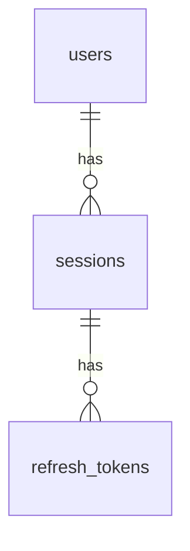

# Community Events Board

Next.js App Router backend. This phase implements signup, signin, token refresh and logout only.

## Run locally

Requires Node.js 22.13+ (or a newer supported release) and PostgreSQL.

1. Install packages with `npm install`.
2. Copy `.env.example` to `.env` if `.env` does not already exist.
3. Set `DATABASE_URL` and a random `JWT_SECRET` (`openssl rand -hex 48`). Keep `.env` private; it is ignored by Git.
4. Apply the additive database migration and start Next.js:

```sh
npm run db:migrate
npm run dev
```

The migration creates the `app_auth` schema with users, sessions, hashed refresh tokens and shared rate limits. It is transactional, tracks migration checksums and can safely be rerun. It does not modify tables in other schemas. Remote PostgreSQL connections use TLS with certificate verification.

## Database schema

The current schema covers authentication and is defined using SQL migrations:

- [db/migrations/001_auth.sql](db/migrations/001_auth.sql) defines the application tables, constraints and indexes.
- [scripts/migrate.ts](scripts/migrate.ts) creates the PostgreSQL `app_auth` namespace and the migration tracking table, then applies migrations.
- [lib/server/db.ts](lib/server/db.ts) configures the PostgreSQL connection pool using `DATABASE_URL` from `.env`.

In Neon, these tables are under **`app_auth`**, rather than the default `public` schema. This project uses SQL directly through `pg`; there is no Prisma `schema.prisma` file.

| Table | Columns | Purpose |
| --- | --- | --- |
| `app_auth.users` | `id UUID`, `email VARCHAR(254)`, `password_hash TEXT`, `role TEXT`, `created_at TIMESTAMPTZ` | Accounts with a unique normalized email, a password hash and a `USER` or `ADMIN` role. Signup defaults to `USER`. |
| `app_auth.sessions` | `id UUID`, `user_id UUID`, `created_at TIMESTAMPTZ`, `expires_at TIMESTAMPTZ`, `revoked_at TIMESTAMPTZ` | Independent login sessions with absolute expiry and optional revocation. |
| `app_auth.refresh_tokens` | `token_hash CHAR(64)`, `session_id UUID`, `created_at TIMESTAMPTZ`, `used_at TIMESTAMPTZ` | Hashed refresh tokens and their rotation history for replay detection. |
| `app_auth.rate_limits` | `key CHAR(64)`, `attempts INTEGER`, `resets_at TIMESTAMPTZ` | Shared signup/signin attempt counters keyed by a digest of the operation and normalized email. |
| `app_auth.schema_migrations` | `name TEXT`, `checksum CHAR(64)`, `applied_at TIMESTAMPTZ` | Applied migration filenames, checksums and timestamps. |



`sessions.user_id` references `users.id`, and `refresh_tokens.session_id` references `sessions.id`. Both foreign keys use `ON DELETE CASCADE`. Logout sets `revoked_at` rather than deleting rows. A partial unique index permits only one unused refresh token per session; previously used token hashes remain available for replay detection.

Apply pending schema changes with `npm run db:migrate`. Add new numbered SQL files in `db/migrations/` for future changes; do not edit an already-applied migration, because the runner verifies its checksum.

## Authentication API

| Method | Endpoint | Request |
| --- | --- | --- |
| POST | `/api/auth/signup` | JSON `{ "email": "visitor@example.com", "password": "a-long-example-passphrase" }` |
| POST | `/api/auth/signin` | The same email/password JSON |
| POST | `/api/auth/refresh` | JSON `{ "refreshToken": "<current refresh token>" }` |
| POST | `/api/auth/logout` | `Authorization: Bearer <access token>`; no body |

Signup and signin return a safe user object, a 15-minute access JWT and a refresh token. Refresh rotates both tokens without extending the seven-day session lifetime. Logout revokes the current session immediately, including its existing access JWTs. Other sessions stay signed in.

See [the API guide](docs/auth-api.md) for response shapes, error codes, middleware and client integration. [The OpenAPI contract](docs/openapi.yaml) can be imported into Postman.

## Verify

```sh
npm test
npm run lint
npm run typecheck
npm run build
```

With the server running and the database migrated:

```sh
npm run test:api
```

Integration tests use the `.env` database, create uniquely named synthetic accounts and remove only those accounts and rate-limit entries afterward. Set `TEST_BASE_URL` if the server is not at `http://127.0.0.1:3000`. Tests validate responses against OpenAPI and cover token rotation, replay, races, role checks, logout, expiry and throttling against real PostgreSQL. For CI, use a dedicated Neon branch and the same `.env` configuration for the API and tests.
